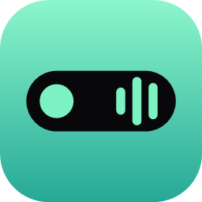
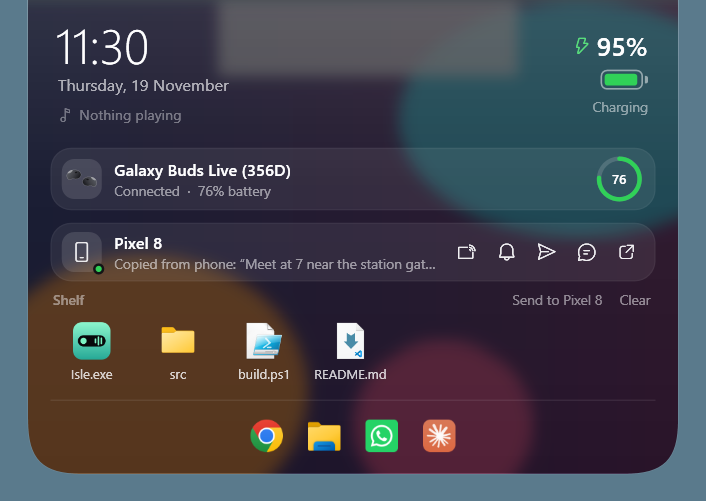
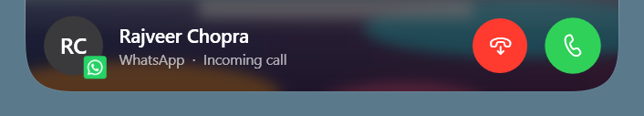
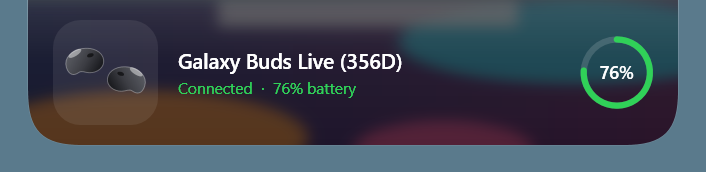
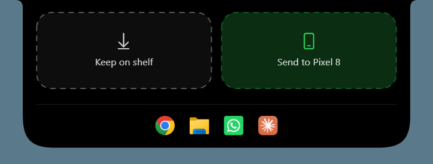
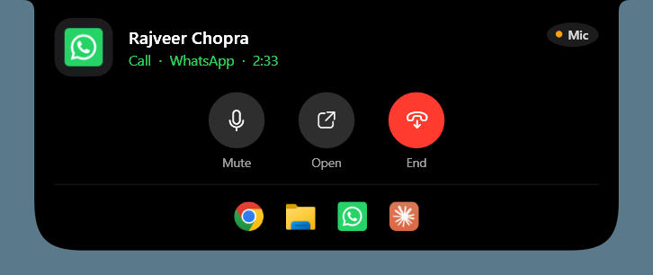
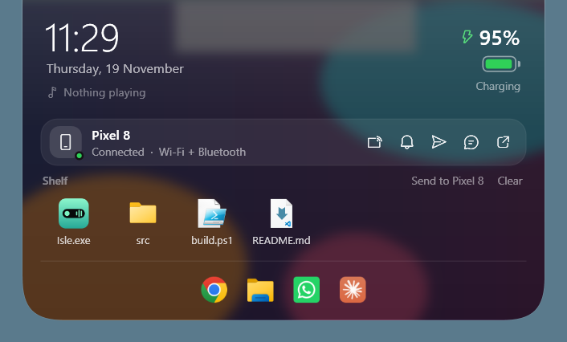
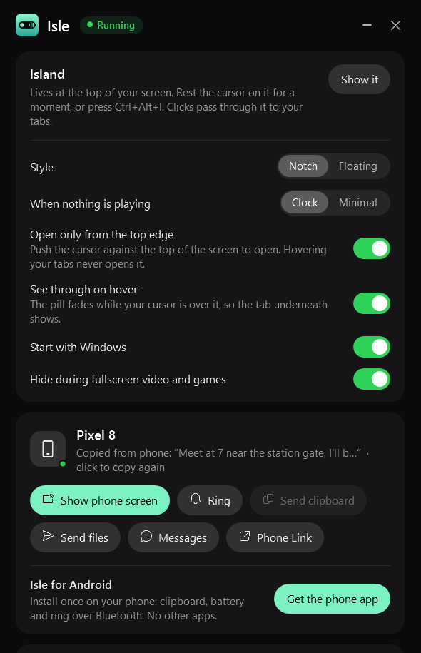
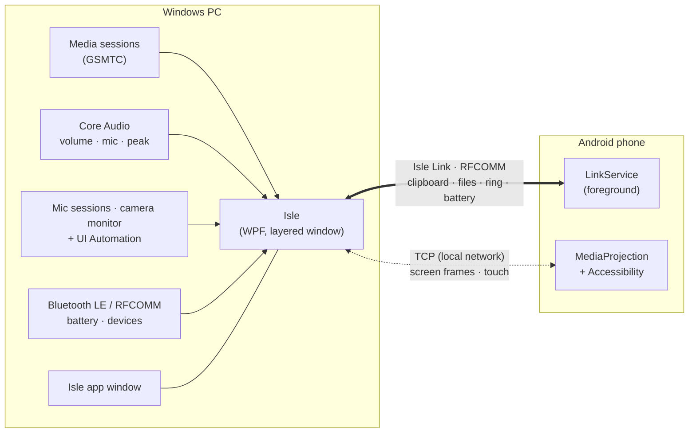

<div align="center">



# Isle

**A fast, native Dynamic Island for Windows, with your Android phone built in.**

Music, calls, earbuds, volume, files and your phone's clipboard, all in one living pill at the top of your screen.

[](https://github.com/rajveer-lab/isle/releases/latest)
&nbsp;

&nbsp;


[](LICENSE)

<br/>



</div>

---

## Why Isle

Most "dynamic island" apps for Windows are heavy web or UWP shells that lag and sit on top of your browser tabs. Isle is a small native app built for one job and built to stay out of your way.

- **Lightweight.** About 0.05 % CPU when idle, with no runtime to install, because .NET Framework 4.8 already ships with Windows.
- **Never in the way.** The small pill lets clicks pass through it to the tab underneath. It only opens when you push the cursor against the top edge, and it fades see-through while you hover.
- **Real frosted glass.** The black pill opens into frosted glass: whatever is behind it on screen shows through, blurred, with a light rim along the edge. Windows has no backdrop blur for custom-shaped windows, so Isle makes its own.
- **Smooth.** Spring physics morph the width, height and squircle corners in one motion, with a soft blur in between.
- **Your phone, with no extra apps.** Isle Link is its own Bluetooth protocol, paired once and connected automatically after that. You don't need Phone Link, KDE Connect or any cloud account.

## Features

<table>
<tr>
<td width="50%" valign="top">

### 🎵 Now playing
Album art and live bars sit in the pill. Opened, the island shows a seek bar, playback controls, volume, and a glow tinted by the album art. The bars and buttons take on the art's colour. It works with any app that reports what's playing to Windows: Spotify, Chrome, Edge, YouTube Music and more. The playing app's icon sits in the corner. With several things playing, swipe sideways on the touchpad (or Shift + scroll) to slide between them.

**Every browser tab, not just the last one.** Windows only sees the tab a browser played last. With the small Isle extension for Chrome, Edge or Brave, each tab that's playing gets its own entry, and a heart button likes the song on YouTube Music (or the video on YouTube) without opening the tab.

</td>
<td width="50%" valign="top">

### 📞 Calls
- **Incoming calls:** shows the caller with Decline and a pulsing Accept.
- **During a call:** a timer, plus Mute, which mutes the mic in every app, and End.
- **Works with** WhatsApp, Telegram, Discord, Teams, Zoom, browser calls, and phone calls through Phone Link.



</td>
</tr>
<tr>
<td valign="top">

### 🎧 Earbuds
An AirPods-style card drops in when Bluetooth earbuds connect. It shows a drawing of your buds and an animated battery ring. The buds' battery stays visible in the island, and you get a warning when it's low.



</td>
<td valign="top">

### 🔊 Volume & brightness
Isle replaces Windows' volume pop-up with its own slim pop-up in the island. Brightness, the mic key, charging and device changes show there too. A privacy dot lights up while the mic or camera is in use.


</td>
</tr>
<tr>
<td valign="top">

### 📱 Isle Link: your Android phone
- **Clipboard:** copy on the phone and press Ctrl+V on the laptop, or send the laptop's clipboard to the phone.
- **Files:** send them to the phone from the island, from the app window or with Explorer's *Send to*.
- **Find your phone:** rings it at full volume, even on silent.
- **Battery:** shows the phone's battery and charging state.
- **Screen mirroring:** a live view of the phone screen. You can tap, swipe and type on it.


</td>
<td valign="top">

### 🗂️ Shelf & quick apps
Drag files onto the island, then drop them on **Keep on shelf** to park them for later, or on **Send to phone**. A row of quick apps can be edited from the app window.



</td>
</tr>
</table>

<details>
<summary><b>More screenshots</b></summary>
<br/>

| Ongoing call | Shelf + phone |
|---|---|
|  |  |

| The Isle app window | Compact pill |
|---|---|
|  |  |

</details>

## Install

1. Download **`IsleSetup.exe`** from the [latest release](https://github.com/rajveer-lab/isle/releases/latest). It's a single file of about 230 KB.
2. Run it and click **Install**.
   - No admin rights are needed. Isle installs per user into `%LOCALAPPDATA%\Programs\Isle`.
   - It adds a Start menu entry, optional auto-start and an Explorer *Send to › Phone (Isle)* entry.
3. To connect your phone, download **`Isle-Phone.apk`** from the same release and install it on your Android phone.
   - Open it, allow Bluetooth and notifications, and pick your laptop.
   - From then on, the two reconnect by themselves.

To update, run a newer `IsleSetup.exe`. To uninstall, go to **Settings › Apps › Installed apps › Isle**. For a silent install, use `IsleSetup.exe /quiet`.

## Usage

| Action | How |
|---|---|
| Open the island | Push the cursor against the top edge of the screen above the pill, or press **Ctrl+Alt+I** |
| Open settings | Start menu › **Isle**, or the tray icon |
| Change volume | Scroll over the island, or use the volume keys |
| Send files to the phone | Drag them onto the island, use *Send files*, or right-click › *Send to › Phone (Isle)* |
| Paste the phone's clipboard | Copy on the phone, tap **Copy to laptop**, then press **Ctrl+V** |
| Switch between players / tabs | Swipe sideways on the open island, Shift + scroll, or click the app icon |
| Connect browser tabs | Isle app window › **Browser tabs › Set up**, then in Chrome: Developer mode › **Load unpacked** › the folder that opened |

Every option is also in `%APPDATA%\Isle\settings.ini`, which is commented.

## How it works



- **Island window.** A transparent, top-most tool window. It lets clicks through while compact, and it is driven by a spring simulation that animates the width, height and corner radius.
- **Glass.** While the island is open, a background thread grabs the strip of screen behind it a few times a second. The island hides itself from that grab with `WDA_EXCLUDEFROMCAPTURE`, only for a moment, so your own screenshots still show it. The grab is shrunk with area averaging and stretched back up under a blur shader and a dark tint. Nothing is saved, and it stops as soon as the island closes.
- **Media.** Uses Windows' media session API (`GlobalSystemMediaTransportControls`). A colour taken from the album art drives the glow and the controls.
- **Calls and the privacy dot.** Mic use comes from live Core Audio capture sessions and camera use from Media Foundation's sensor activity monitor, with Windows' privacy usage records as a fallback. Caller names and the Accept, Decline and End buttons are read from call windows and notifications through UI Automation.
- **Browser tabs.** The Isle extension (`browser/`) finds the audio or video you've heard in each tab and runs play, skip, seek and Like inside the page. Chrome starts `Isle.exe` as a native messaging host, which relays to the running Isle over a named pipe that only your Windows account can open. Nothing goes over the network.
- **Isle Link.** A small line-based protocol over Bluetooth RFCOMM, carrying `HELLO`, `CLIP`, `BATT`, `RING`, `FILE`/`DATA`/`FILEEND` and `MIRROR*`. Either side can dial the other, so they reconnect on their own.
- **Phone app.** About 1,000 lines of plain Java built straight against the Android SDK, with no Gradle and no libraries. The APK is about 40 KB.

## Build from source

**Requirements**
- Windows 10 or 11
- [Visual Studio Build Tools](https://visualstudio.microsoft.com/downloads/#build-tools-for-visual-studio-2022), for the Roslyn C# compiler
- The Windows 10/11 SDK
- *Optional, for the phone app:* the Android SDK (platform 35) and Android Studio's JDK

```powershell
git clone https://github.com/rajveer-lab/isle.git
cd isle
powershell -ExecutionPolicy Bypass -File build.ps1
```

| Output | What |
|---|---|
| `bin/Isle.exe` | The app |
| `dist/Isle-Phone.apk` | The Android app, built only if the Android SDK is found |
| `dist/IsleSetup.exe` | A single-file installer that contains everything above |

Debug flags:
- `--pin-expanded` keeps the island open.
- `--snapshot=<folder>` renders every state to PNG and exits. Snapshots draw the glass over a sample wallpaper and never read the real screen.
- `--no-media` leaves out whatever is really playing.

The screenshots in this README were made with `--snapshot` and `--no-media`.

## Project structure

```
isle/
├── src/                  Windows app (C#, WPF)
│   ├── IslandWindow.cs   the island: states, morph, HUDs, input
│   ├── Glass.cs          frosted-glass backdrop (screen behind, blurred)
│   ├── Island.xaml       island layout and styles
│   ├── HubWindow.cs      the Isle app window (Hub.xaml)
│   ├── MediaService.cs   now playing, album art, accent colour
│   ├── BrowserBridge.cs  link to the browser extension (every playing tab)
│   ├── CallService.cs    call detection and controls
│   ├── SensorUse.cs      live mic / camera use (privacy dot)
│   ├── AudioService.cs   volume, mic mute, peak meter
│   ├── IsleLink.cs       Bluetooth protocol (laptop side)
│   ├── Phone.cs          phone status, clipboard, file sending
│   ├── MirrorWindow.cs   phone screen viewer
│   └── EarbudsArt.cs     vector earbuds drawings
├── browser/              Isle extension for Chrome / Edge / Brave
├── android/              Isle for Android (Java)
├── setup/                single-file installer
├── docs/                 logo and screenshots
└── build.ps1             one-command build
```

## Roadmap

- [ ] Microsoft Store package (MSIX)
- [ ] Faster binary file transfer over Isle Link
- [ ] Turn on the hotspot automatically for screen mirroring on networks that block device-to-device traffic
- [ ] Multi-monitor placement options

## License

[MIT](LICENSE) © Rajveer Singh Chopra
